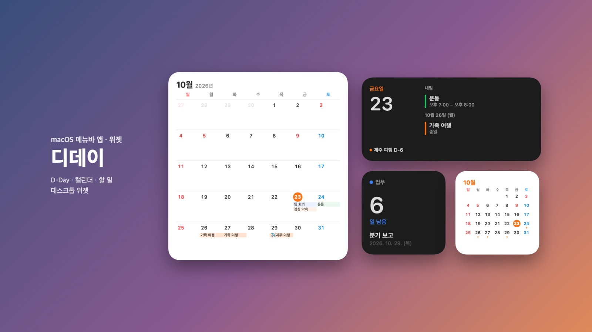
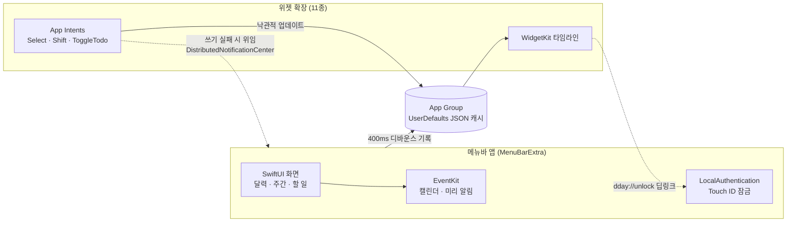
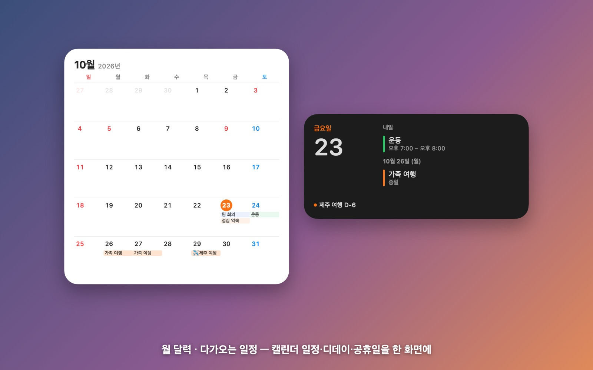
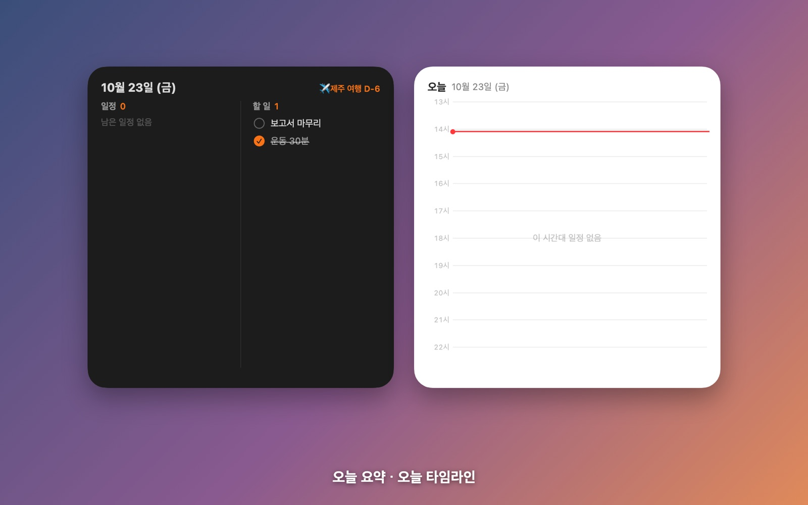
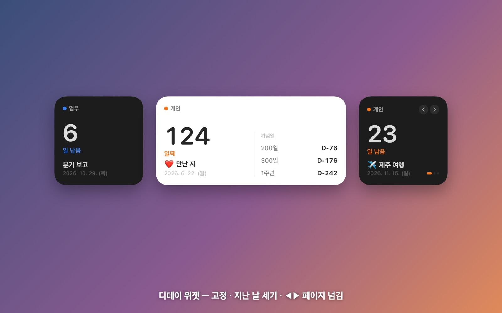
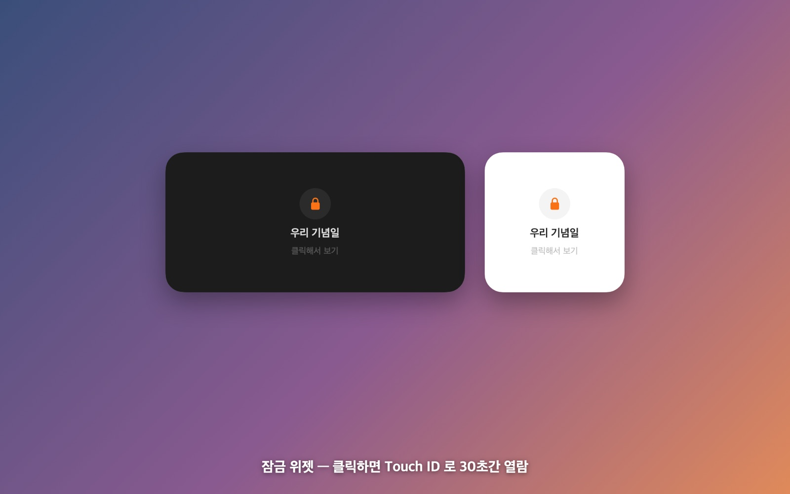
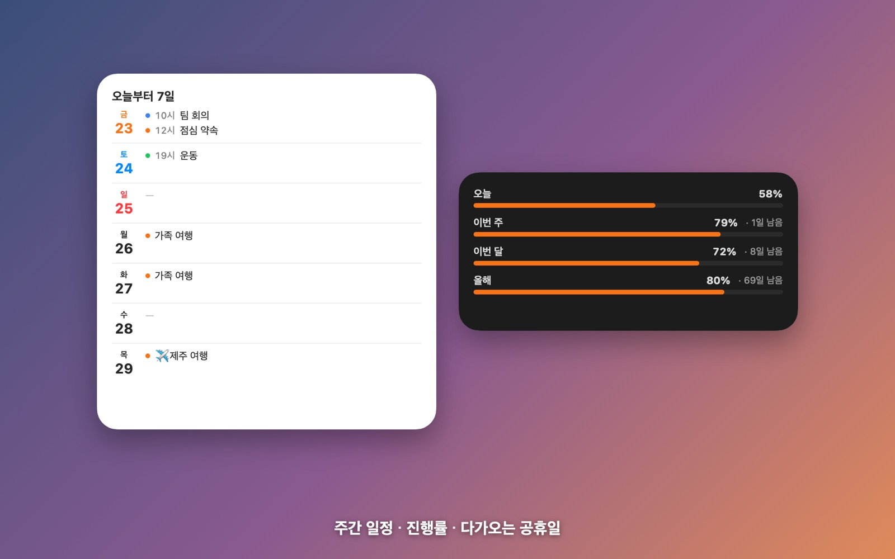
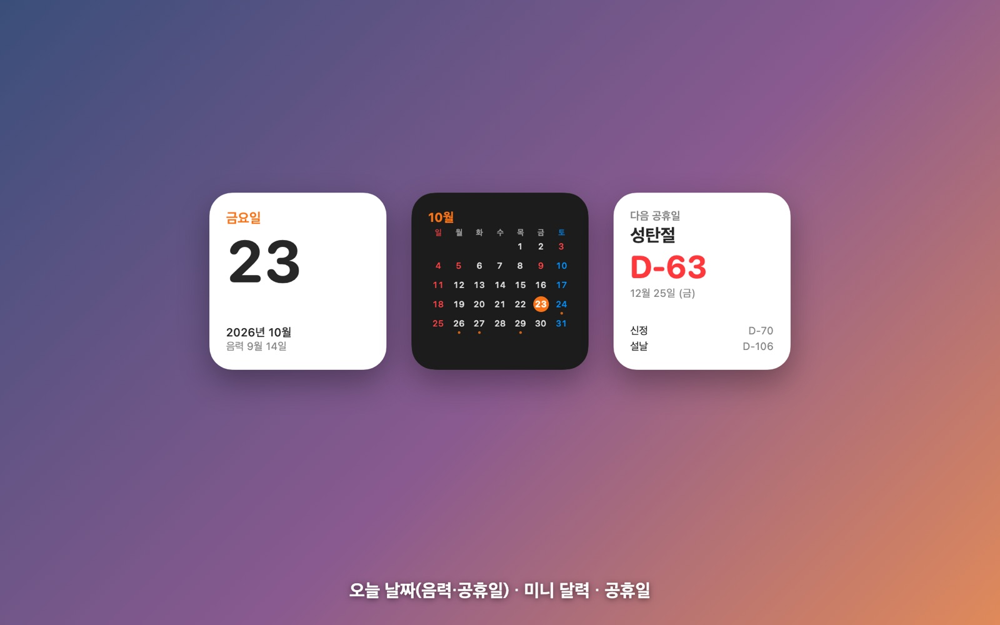

# 디데이 (DDay)

디데이, Apple 캘린더 일정, 미리 알림을 메뉴바 앱과 데스크톱 위젯 11종으로 보여 주는 macOS 네이티브 앱입니다.
App Intents 기반 인터랙티브 위젯으로 앱을 열지 않고도 일정을 보고 할 일을 완료할 수 있습니다.

**[포트폴리오 상세](https://simhyeoncheol.vercel.app/portfolio-details-dday.html)**

> 이 저장소는 프로젝트 소개용입니다. 소스 코드는 비공개 저장소에서 관리하며, 면접 등에서 요청하시면 열람 권한을 드립니다.

| 항목 | 내용 |
|---|---|
| 기간 | 2026.10 |
| 역할 | 1인 개발 |
| 플랫폼 | macOS 14+ (메뉴바 앱 + 데스크톱 위젯) |

## 기술 스택

Swift · SwiftUI · AppKit · WidgetKit · App Intents · EventKit · LocalAuthentication · XcodeGen · XCTest

## 기술 선택 이유

### Swift 네이티브 (Electron · Tauri 같은 크로스플랫폼 대신)
| 검토한 선택지 | 판단 |
|---|---|
| Electron · Tauri (웹 기술) | 메뉴바 앱은 만들 수 있지만 **macOS 데스크톱 위젯은 만들 수 없음** |
| **Swift + SwiftUI (채택)** | WidgetKit · App Intents · EventKit · Touch ID를 모두 OS API로 직접 사용 |

- 이 앱의 핵심은 바탕화면 위젯 11종입니다. macOS 위젯은 WidgetKit 확장으로만 만들 수 있어서 네이티브가 사실상 유일한 선택이었습니다.
- Apple 캘린더 · 미리 알림(EventKit)과 Touch ID(LocalAuthentication)도 OS API를 직접 써야 해서, 앱과 위젯을 같은 언어로 맞췄습니다.

### SwiftUI + AppKit 혼용
- 화면은 SwiftUI(`MenuBarExtra`)로 빠르게 만들고, SwiftUI만으로 안 되는 부분은 AppKit으로 보완했습니다. 예를 들어 로그인 시 자동 실행됐을 때 창을 띄우지 않거나, SwiftUI 뷰 밖(AppKit 경로)에서 창을 여는 동작입니다.

### 최소 지원 버전 macOS 14
- 위젯 안에서 버튼을 눌러 페이지를 넘기거나 할 일을 완료하는 **인터랙티브 위젯(App Intents)**은 macOS 14부터 지원됩니다. 앱을 열지 않고 위젯에서 바로 조작하는 것이 핵심 기능이라 최소 버전을 14로 정했습니다.

### 앱 ↔ 위젯 공유: App Group UserDefaults
- 위젯은 앱과 다른 프로세스라 앱 메모리를 볼 수 없습니다. 공유할 데이터가 디데이 목록과 일정 · 할 일 캐시 정도라, 별도 데이터베이스 없이 **App Group UserDefaults에 JSON**으로 두는 가장 가벼운 방식을 택했습니다.
- 위젯에 캘린더 권한이 있으면 EventKit을 직접 읽고, 없으면 이 캐시로 대신 보여 줍니다.

### XcodeGen
- Xcode 프로젝트 파일(`.pbxproj`) 대신 `project.yml`로 타깃(앱 · 위젯 · 테스트)과 권한 설정을 관리합니다. 설정이 사람이 읽을 수 있는 텍스트로 남아 변경 내역을 추적하기 쉽습니다.

## 구조

## 화면

| | |
|---|---|
|  월 달력, 다가오는 일정 |  오늘 요약, 오늘 타임라인 |
|  디데이 위젯 (고정, 지난 날 세기, 페이지 넘김) |  잠금 위젯 (Touch ID로 30초간 보기) |
|  주간 일정, 진행률 |  음력 · 공휴일, 미니 달력 |

## 주요 기능

- **설정 가능한 인터랙티브 위젯:** `SelectDDayIntent`로 위젯마다 디데이 · 분류 · 잠금을 고르고, 스와이프가 없는 위젯에서 `ShiftDDayIntent` 버튼으로 페이지를 넘깁니다. WidgetKit이 인스턴스 ID를 주지 않아 구성값과 크기로 인스턴스 키를 만듭니다.
- **잠금 위젯과 생체 인증:** 위젯은 인증 UI를 띄울 수 없어 `dday://unlock` 딥링크로 앱에 위임하고, 인증에 성공하면 해당 위젯만 30초간 풉니다. 재잠금 시점은 타임라인 엔트리로 미리 예약합니다.
- **위젯에서 EventKit 쓰기:** `ToggleTodoIntent`가 캐시를 먼저 갱신한 뒤 `EKReminder`를 저장하고, 위젯 프로세스에서 쓰기가 막히면 대기 큐와 `DistributedNotificationCenter`로 앱에 넘깁니다.

## 기술적 과제와 해결

### 1. 한국 공휴일 · 대체공휴일 규칙 엔진
- **문제:** 대체공휴일 규칙이 공휴일마다 다르고(설·추석은 일요일·공휴일 겹침만, 삼일절·어린이날 등은 토·일 모두, 신정·현충일은 비대상), 대체일이 다시 겹치면 연쇄적으로 밀립니다. Foundation `.chinese` 달력은 2027·2028년 설날을 한국 음력과 하루 다르게 계산합니다.
- **해결:** 공휴일 테이블에 대체 대상 여부를 선언적으로 두고 `nextFreeWeekday`로 다음 평일을 찾습니다. 설날 오차는 보정 테이블로 처리하고, 연도별 결과는 `NSLock`으로 보호한 캐시에 두어 앱 시작 시 전년 · 당해 · 익년을 백그라운드에서 미리 계산합니다.
- **결과:** 2025 · 2026년 경계 케이스를 테스트로 고정, 연간 계산 20ms 미만 성능 테스트.

### 2. 주간 타임그리드의 겹치는 일정 레이아웃
- **해결:** 일정을 당일 범위로 자르고 최소 높이를 15분으로 둔 뒤, 겹침이 이어지는 일정을 클러스터로 묶어 그리디하게 빈 열에 배정합니다. 겹침 없는 일정은 전체 폭을 씁니다.

### 3. EventKit 조회 제한과 반복 일정 회차 식별
- **문제:** EventKit 단일 조회는 4년으로 제한되고, 반복 일정의 모든 회차가 같은 `eventIdentifier`를 가져 SwiftUI 목록 identity가 충돌합니다.
- **해결:** 조회를 1년 단위로 나누고 경계 중복은 Set으로 제거, 회차 identity를 `eventIdentifier + 시작 시각`으로 정의했습니다. 늦게 도착한 응답은 fetch token으로 버립니다.

### 4. 앱 ↔ 위젯 프로세스 간 데이터 공유
- **해결:** App Group UserDefaults에 JSON으로 공유하고, 쓰기를 400ms 디바운스로 묶어 `reloadAllTimelines()`를 호출합니다. 위젯에 캘린더 권한이 없으면 앱이 남긴 캐시로 fallback합니다.

### 5. 메뉴바 앱의 잠금 상태 전이와 창 생명주기
- **해결:** 패널이 닫힐 때 · 슬립 · 화면 꺼짐 · 세션 전환 시 앱과 위젯의 해제 상태를 모두 초기화합니다. `SMAppService.mainApp`으로 로그인 항목을 등록하고, Apple Event로 로그인 실행을 감지해 창을 띄우지 않습니다.

### 6. 비결정적 데이터 소스의 안정 정렬
- **해결:** 마감일 → 우선순위 → 제목 → ID로 결정적 정렬 키를 정의하고 완료 여부는 키에서 빼서, 할 일을 완료해도 항목 위치가 바뀌지 않게 했습니다.

## 테스트

- XCTest 32개 (디데이 계산, 윤년, 잠금 타임라인, 대체공휴일)
- 일정 504개를 100ms 안에 다시 그리는지 성능 테스트
- 위젯 11종 × 크기 × 라이트/다크 조합을 PNG로 렌더링하는 스냅샷 도구 제작

## 연락처

- 포트폴리오: https://simhyeoncheol.vercel.app
- 이메일: simhyeoncheol3@gmail.com
